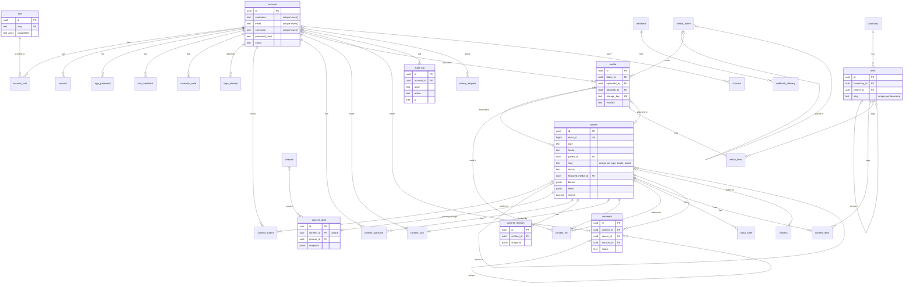

# Data model

The core tables of toascribe in PostgreSQL 18, as built in M0.2. The specification is the table in
[PLAN.md](PLAN.md) («Datamodell i PostgreSQL»); this file explains how it was turned into a schema and lists every place
the schema differs from it. The schema is in `packages/db/src/schema/` (one file per domain), the migration in
`packages/db/migrations/`, the value sets and JSON shapes in `packages/shared/src/values.ts` and `documents.ts`.

## Conventions

- **Ids:** `id uuid primary key default uuidv7()` on every table (built into PostgreSQL 18, time-ordered). Link tables
  (`account_role`, `content_author`, `content_term`, `media_term`) have a composite primary key instead.
  `content.short_id` is a `bigint generated always as identity` for `/?p=` links.
- **Time:** every timestamp is `timestamptz`. Tables whose rows change have `created_at` and `modified_at`, both
  `not null default now()`. The repository layer sets `modified_at = now()` in each UPDATE; there is no trigger and no
  Drizzle `$onUpdate`. Append-only tables have `created_at` only.
- **Value sets:** `text` with a named `CHECK (col IN (...))`, never a PostgreSQL enum. The list lives once in
  `@toascribe/shared` and gives the TS type, the Zod schema and the CHECK; a test compares the lists with the database.
- **JSONB:** typed with `$type<...>()` from `@toascribe/shared`, `not null` with `'{}'` or `'[]'` where empty is natural.
- **Secrets:** passwords, tokens and codes are stored as `*_hash`. Secrets that must be read back (a TOTP secret, a
  webhook signing secret) are `*_encrypted` (K-318).
- **Names:** tables singular, as in PLAN. Indexes `idx_<table>_<columns>`, unique constraints and indexes
  `uq_<table>_<columns>`, foreign keys `fk_<table>_<column>`, checks `ck_<table>_<rule>`, composite keys `pk_<table>`.
- **Indexes:** every foreign key column leads some index (a test checks it), because every referenced row can be
  deleted. Other indexes only for a lookup PLAN or the function register names.
- **Privileges:** the app role gets DML on every table from the default privileges in `docker/postgres/init.sql`
  (including the identity sequence). `audit_log` is append-only: the app role has INSERT and SELECT there and nothing
  else. The 90-day IP clean-up is the function `audit_log_clear_old_ips()` (below), which the app role may only execute.
  Both are in the hand-written custom migration `0001_audit_log_privileges.sql` (`drizzle-kit generate --custom`), so a
  regenerate of `0000_core` cannot drop them.

## Diagram

Columns are abbreviated to keys and the columns the links use.

Tables without links to the others: `content_type`, `field_group`, `template`, `menu`, `area`, `global_set`, `pattern`,
`setting`, `oembed_cache`, `not_found_log`, `workflow`, `extension_state`, `backup`.

## content, content_draft and content_revision

- **`content` holds the published version** of an item, or the item itself while it has never been published. `status`
  is visibility (draft, pending, future, publish, private, trash); `workflow_state` is only the editorial step and never
  publishes. In phase 1 «Update» writes straight to `content`, as in WordPress.
- **`content_draft` is the one pending change** to published content (phase 2, «Save as pending change»): at most one row
  per item (`uq_content_draft_content_id`), holding the edited fields as a JSON snapshot, optionally part of a
  `release`. Publishing it copies the snapshot into `content` and deletes the draft.
- **`content_autosave`** is one row per user and item, overwritten every 30 seconds.
- **`content_revision`** is a snapshot taken on save and on publish. The service keeps the newest 25 per item by default
  and deletes older ones; rows are never edited.

Drafts, autosaves and revisions store a `snapshot` (JSONB) of the editable fields instead of copying every column of
`content`, so a new column on `content` does not need the same column in three more tables.

## Full-text search

`content.search` is a plain `tsvector` column with a GIN index, written by the content service on every save, not a
generated column. The text comes partly from the block tree, and only the block registry knows which attributes are
text; and the text search configuration depends on the item's `locale`, which a generated column cannot look up in a
setting. The service builds `setweight(to_tsvector(cfg, title), 'A') || setweight(to_tsvector(cfg, excerpt), 'B') ||
setweight(to_tsvector(cfg, block text), 'C')`.

Open for K-240 (phase 2): the mapping from locale to configuration. PostgreSQL ships `norwegian` (Snowball, used for
both `nb` and `nn`) and `english`; `simple` is the fallback for a language without one. A query must use the same
configuration as the vector it searches, so search filters by locale first. Whether to store the configuration per row
(a `regconfig` column) is decided with the search feature.

## ON DELETE

Every foreign key has an explicit action. RESTRICT and SET NULL keep data; CASCADE only removes rows that have no
meaning without the parent.

| Foreign key                                   | Action   | Why                                                                     |
| --------------------------------------------- | -------- | ----------------------------------------------------------------------- |
| `account_role.account_id`                     | CASCADE  | an account's role links go with it                                      |
| `account_role.role_id`                        | RESTRICT | a role still held cannot be deleted; move its accounts first            |
| `session`, `app_password`, `mfa_credential`, `recovery_code` `.account_id` | CASCADE | credentials go with the account |
| `login_attempt.account_id`                    | CASCADE  | rate-limit data has no value once the account is gone                   |
| `content_author.account_id`                   | RESTRICT | deleting an account never deletes content; reassign first (K-021)       |
| `content_author.content_id`                   | CASCADE  | author links go with the content                                        |
| `content.parent_id`                           | SET NULL | children move to the top (the service moves them to the grandparent first) |
| `content.featured_media_id`                   | SET NULL | the content loses its featured image                                    |
| `content_draft.content_id`                    | CASCADE  | a draft is worthless without its content                                |
| `content_draft.account_id`                    | SET NULL | the draft stays when its last editor is deleted                         |
| `content_draft.release_id`                    | SET NULL | drafts of a deleted release become ordinary drafts                      |
| `content_autosave.content_id`, `.account_id`  | CASCADE  | an autosave belongs to one user and one item                            |
| `content_revision.content_id`                 | CASCADE  | revisions go with the content                                           |
| `content_revision.account_id`                 | SET NULL | history stays when its author is deleted                                |
| `content_lock.content_id`, `.account_id`      | CASCADE  | a lock is meaningless without either                                    |
| `content_ref.content_id`, `.target_content_id`, `.target_media_id` | CASCADE | derived rows, rebuilt on every save; the service reads them before a delete |
| `block_note.content_id`                       | CASCADE  | notes go with the content                                               |
| `block_note.account_id`                       | SET NULL | the note stays, without author                                          |
| `term.taxonomy_id`                            | CASCADE  | a taxonomy's terms go with it                                           |
| `term.parent_id`                              | SET NULL | children move to the top (the service moves them up a level first)      |
| `content_term.*`, `media_term.*`              | CASCADE  | links go with either side                                               |
| `media_folder.parent_id`                      | CASCADE  | deleting a folder deletes its subfolders ...                            |
| `media.folder_id`                             | SET NULL | ... and the files in them move to the top of the library                |
| `media.uploaded_by`                           | SET NULL | files stay when the uploader is deleted                                 |
| `media.attached_to`                           | SET NULL | files stay, unattached, when their content is deleted (as in WordPress) |
| `comment.content_id`                          | CASCADE  | as `wp_delete_post()`; trashing content does not touch comments         |
| `comment.parent_id`                           | SET NULL | replies stay (the service moves them up a level first)                  |
| `comment.account_id`                          | SET NULL | the comment stays with its author name                                  |
| `redirect.content_id`                         | CASCADE  | a redirect to deleted content has nowhere to go                         |
| `webhook_delivery.webhook_id`                 | CASCADE  | the log goes with its webhook                                           |
| `release.account_id`                          | SET NULL | the release stays                                                       |
| `audit_log.account_id`                        | SET NULL | the record stays, without the link; `actor` keeps the username          |
| `privacy_request.account_id`, `consent.account_id` | SET NULL | the proof stays when the account is erased                         |

Referential actions run as the table owner, so SET NULL on `audit_log` works although the app role has no UPDATE there.
Only `account_id` changes; `actor`, written on every row, still names who did it (Tor's decision, 2026-10-21).

## Seed data

`seedCore(db)` in `@toascribe/db` writes the rows a site needs before anyone logs in. The migration step calls it after
the Drizzle migrations and pg-boss, under the same lock and as the owner role, so `docker compose up` on an empty volume
ends with them in place; `toa core install` and the tests call it as well. It seeds no accounts, no content and no
secrets.

- **`role`:** the five built-in roles, `administrator`, `editor`, `author`, `contributor` and `subscriber`, with WordPress'
  English display names and capability lists (50, 26, 7, 3 and 1 names, WordPress 7.1.3 `populate_roles()`). The
  lists are `DEFAULT_ROLES` and `CAPABILITIES` in `@toascribe/shared`. Meta capabilities (`edit_post`, ...) are resolved
  in code, never stored. The admin translates built-in role names by slug.
- **`setting`:** one row per key of `CORE_SETTINGS` in `@toascribe/shared`, the WordPress option names and install-time
  defaults for the General, Reading, Discussion, Media and Permalinks pages, typed (booleans and numbers, not WordPress'
  strings) and validated by `CoreSettings`. Changes from WordPress: an empty site title, `locale` `nb` (WordPress
  `WPLANG`), day-and-name permalinks, and the date format, time format, week start and time zone of WordPress' nb_NO
  translation. The mapping is listed in `packages/shared/src/settings.ts`.

It only inserts what is missing (`ON CONFLICT DO NOTHING` on `role.slug` and `setting.key`), in one transaction. A run
never updates a row: a setting an administrator changed and a role whose capabilities were edited keep their values. A
deleted built-in role or core setting comes back on the next run. It needs INSERT only, so the app role can run it too.

## Deviations from PLAN

Where PLAN names a column, the schema uses its name. These are the places it differs, or adds what PLAN leaves open.

**Renamed or reshaped**

- `content.password` is `password_hash` (Argon2id). WordPress keeps the post password in plain text and shows it to
  editors; here it can be replaced, not read (security standard: hashes only). WXR import hashes it.
- `media` «dimensjoner» is two columns, `width` and `height` (null for files without them); «størrelse» is `size` in
  bytes.
- `backup` «start og slutt» is `started_at` and `finished_at`; «størrelse» is `size`; «lagringsmål» is `target`
  (local, s3, sftp) plus `location` (path or key there); «verifisert» is `verified_at` (when the restore test passed).
- `block_note` «tekst» is `body`, «løst» is `is_resolved`. `oembed_cache` «utløper» is `expires_at`.
- `role` capabilities are a `text[]` of capability names, not JSONB.
- `comment` has `modified_at` as well as `created_at` (moderation and editing change rows).
- `extension_state` «aktiv» is `is_active` (boolean prefix, PostgreSQL standard «Navnekonvensjoner»).
- The built-in roles store WordPress' capabilities without the deprecated `level_0` ... `level_10`, which WordPress
  still writes for old plugins. Nothing reads them, and WXR does not carry roles (see «Seed data»).

**Decisions PLAN leaves open**

- Content slugs are unique per (type, locale, parent) with `NULLS NOT DISTINCT`, so two top-level items collide.
  Trashed items take part: like WordPress, the service renames a trashed slug to `<slug>__trashed`. A slug is always
  set and never empty (WordPress allows an empty `post_name` on drafts); the service makes one from the title, or from
  `short_id`. A parent deleted without moving its children first can fail on a slug clash when they move to the top.
- Term slugs are unique per taxonomy, not per taxonomy and parent: archive URLs resolve by the slug alone, and WordPress
  gives a clashing child a suffixed slug.
- Usernames, e-mail addresses and nicenames are unique case-insensitively through unique indexes on `lower(col)`.
  `citext` would need an extension, and so superuser rights at install. Lookups must use `lower(col) = lower($1)`.
- `content.type` is not a foreign key: types defined in code have no `content_type` row.
- `content.workflow_state` has no CHECK: its values are the step keys of a `workflow`.
- `content.search` is filled by the service (see «Full-text search»).
- `content.legacy_wp_id` is neither unique nor indexed: two different WordPress sites can be imported, and the index
  comes with the importer (K-200).
- Menu locations are not a table: a theme's locations map to menus in its settings (`extension_state.settings`).
- `not_found_log` keeps one row per path with a hit count and the last referrer, no IP or user agent.
- `audit_log` has the fields of product-ux workflows §20: `account_id`, `actor_type` and `actor` (automations are never
  attributed to a person), `action`, `object_type`, `object_id`, `old_value`, `new_value`, `reason`, `source`,
  `correlation_id`, `ip`.
  - **`actor`** is NOT NULL and never blank (`ck_audit_log_actor`), and is written on every row: the account's username
    at the time when `actor_type` is `account`, otherwise the job, extension slug, or AI model or tool. It is never
    changed, so deleting an account (which sets `account_id` to null) does not erase who acted.
  - **Privileges:** the app role has INSERT and SELECT only: no UPDATE on any column, no DELETE, no TRUNCATE.
  - **IP clean-up:** `audit_log_clear_old_ips()` sets `ip` to null where `created_at` is more than 90 days old and
    returns how many rows it cleared. It is `SECURITY DEFINER`, owned by `toascribe_owner`, with
    `search_path = pg_catalog, pg_temp`, and takes no argument, so a caller cannot shorten the 90 days or touch another
    column. EXECUTE is revoked from PUBLIC and granted to `toascribe_app` only. A worker job (not written yet) calls it
    (`select audit_log_clear_old_ips()`); old rows are never deleted by the app role.
- `consent` is append-only, one row per decision and category; the newest row per `subject_key` and category is the
  current choice.

**Columns added where PLAN is silent** (all needed by phase 0–2 rows of the function register)

- `account`: `locale` null means the site language.
- `session`: `token_hash`, `user_agent`, `expires_at`, `last_seen_at`.
- `app_password`: `name`, `password_hash`, `last_used_at`, `last_used_ip` (K-016).
- `mfa_credential`: `type` (totp, passkey, oidc), `name`, `secret_encrypted`, `issuer`, `external_id`, `data`,
  `confirmed_at`, `last_used_at`. One passkey or OIDC identity can belong to one account only.
- `recovery_code`: `code_hash`, `used_at`. `login_attempt`: `action`, `succeeded`.
- `content_type`, `field_group`, `global_set`, `workflow`: `key`, `name`. `menu`, `pattern`: `slug`.
- `content_draft`, `content_autosave`, `content_revision`: `snapshot`, `account_id`.
- `content_ref`: `kind`, `target_content_id`, `target_media_id`, `target_url`, `block_id`.
- `template`: `theme`, `title`. `area`: `theme`, `key`, `blocks`. `pattern`: `title`, `is_synced`, `categories`.
- `taxonomy`: `slug`, `name`, `is_hierarchical`, `content_types`. `term`: `taxonomy_id`, `parent_id`, `slug`, `name`.
- `media_folder`: `parent_id`, `name`.
- `redirect`: `source`, `target` or `content_id`, `status_code` (301, 302, 307, 308, 410), `origin`.
- `webhook`: `name`, `url`, `events`, `secret_encrypted`, `is_active`. `webhook_delivery`: `event`, `payload`, `status`,
  `attempts`, `response_status`, `error`, `duration_ms`, `delivered_at`.
- `release`: `title`, `description`, `status`, `publish_at`, `published_at`, `account_id`.
- `extension_state`: `kind`, `slug`, `version`, `settings`, `approved_permissions`, `auto_update`,
  `last_error`.
- `privacy_request`: `type`, `email`, `account_id`, `status`, `token_hash`, `confirmed_at`, `completed_at`.
- `consent`: `subject_key`, `account_id`, `category`, `granted`, `policy_version`.
- Unique keys longer than 2048 characters are refused (`oembed_cache.url`, `redirect.source`, `not_found_log.path`), to
  stay under the btree entry limit.

**Differences from the PostgreSQL standard** (PLAN and the project rules take precedence)

- Tables are singular (`account`, `content`), as PLAN names them; the standard uses plural.
- `modified_at`, not `updated_at` (PLAN), and no trigger for it (see «Conventions»).
- Append-only and link tables have no `modified_at`: `login_attempt`, `content_revision`, `content_ref`, `audit_log`,
  `consent`, `account_role`, `content_author`, `content_term`, `media_term`.
- Foreign keys are named `fk_<table>_<column>`, not `fk_<table>_<referenced_table>`: several tables have two keys to the
  same table (`content.parent_id`, `media.uploaded_by` and `media.attached_to`).
- `content.sticky` and `setting.autoload` keep their PLAN and WordPress names without the `is_` prefix.
- Both `uuid` ids and one `bigint` identity (`content.short_id`, not a primary key).
