# Data model

The core tables of toascribe in PostgreSQL 18, as built in M0.2 and extended in M0.3 (login and accounts) and M0.4
(installation). The
specification is the table in [PLAN.md](PLAN.md) («Datamodell i PostgreSQL»); this file explains how it was turned into
a schema and lists every place the schema differs from it. The schema is in `packages/db/src/schema/` (one file per
domain), the migrations in `packages/db/migrations/`, the value sets and JSON shapes in `packages/shared/src/values.ts`
and `documents.ts`.

| Migration                       | Release | What it does                                                                           |
| ------------------------------- | ------- | -------------------------------------------------------------------------------------- |
| `0000_core`                     | 0.2.0   | the 43 PLAN tables (generated)                                                         |
| `0001_audit_log_privileges`     | 0.2.0   | audit_log append-only for the app role, `audit_log_clear_old_ips()` (custom)            |
| `0002_account_token_session`    | 0.3.0   | `account_token`; `session.mfa_verified_at` and `session.is_remembered` (generated)     |
| `0003_rights_ip_retention`      | 0.3.0   | editor without `unfiltered_html`, `default_role` never administrator, IP retention from the setting (custom) |
| `0004_login_attempt_login_hash` | 0.3.0   | `login_attempt.login_hash` and its index; removes the two lockout settings (generated; the `DELETE` is added by hand) |
| `0005_install_state`            | 0.4.0   | `site_secret` and `admin_notice` (generated); a site from before M0.4 with an active administrator counts as installed (added by hand) |
| `0006_setup_attempts`           | 0.4.0   | `login_attempt.action` also accepts `setup` (generated); `SELECT` on `drizzle.__drizzle_migrations` for the app role (added by hand) |

Drizzle has no down migrations. A published migration is never edited; a change is a new migration.

## Conventions

- **Ids:** `id uuid primary key default uuidv7()` on every table (built into PostgreSQL 18, time-ordered). Link tables
  (`account_role`, `content_author`, `content_term`, `media_term`) have a composite primary key instead.
  `content.short_id` is a `bigint generated always as identity` for `/?p=` links.
- **Time:** every timestamp is `timestamptz`. Tables whose rows change have `created_at` and `modified_at`, both
  `not null default now()`. The repository layer sets `modified_at = now()` in each UPDATE; there is no trigger and no
  Drizzle `$onUpdate`. Append-only tables have `created_at` only.
- **Value sets:** `text` with a named `CHECK (col IN (...))`, never a PostgreSQL enum. The list lives once in
  `@toascribe/shared` and gives the TS type, the Zod schema and the CHECK; a test compares the lists with the database.
- **JSONB:** typed with `$type<...>()` from `@toascribe/shared`, `not null` with `'{}'` or `'[]'` where empty is natural.
- **Secrets:** passwords, tokens and codes are stored as `*_hash`. Secrets that must be read back (a TOTP secret, a
  webhook signing secret) are `*_encrypted` (K-318).
- **Names:** tables singular, as in PLAN. Indexes `idx_<table>_<columns>`, unique constraints and indexes
  `uq_<table>_<columns>`, foreign keys `fk_<table>_<column>`, checks `ck_<table>_<rule>`, composite keys `pk_<table>`.
- **Indexes:** every foreign key column leads some index (a test checks it), because every referenced row can be
  deleted. Other indexes only for a lookup PLAN or the function register names.
- **Privileges:** the app role gets DML on every table from the default privileges in `docker/postgres/init.sql`
  (including the identity sequence). `audit_log` is append-only: the app role has INSERT and SELECT there and nothing
  else. The IP clean-up is the function `audit_log_clear_old_ips()` (below), which the app role may only execute.
  Both are in the hand-written custom migration `0001_audit_log_privileges.sql` (`drizzle-kit generate --custom`), so a
  regenerate of `0000_core` cannot drop them; `0003_rights_ip_retention.sql` replaces the function's body. Every other
  table, `account_token`, `site_secret` and `admin_notice` included, has the default DML, which is all the worker's
  clean-up jobs and the install service need. The one exception that adds rights is `0006_setup_attempts.sql`: `USAGE` on
  the schema `drizzle` and `SELECT` on `drizzle.__drizzle_migrations` (the migrator's own table of hashes and timestamps) for
  the app role, so the system check of the setup wizard can compare the applied migrations with the journal
  (`getMigrationStatus()`). The app role still cannot change or create anything there. The grant sits in a block that does
  nothing when the role does not exist (a database set up without `docker/postgres/init.sql`).

## Diagram

Columns are abbreviated to keys and the columns the links use.

```mermaid
erDiagram
  account ||--o{ account_role : has
  role ||--o{ account_role : "granted by"
  account ||--o{ session : has
  account ||--o{ app_password : has
  account ||--o{ mfa_credential : has
  account ||--o{ recovery_code : has
  account ||--o{ account_token : has
  account |o--o{ login_attempt : "attempts"
  account ||--o{ content_author : writes
  content ||--o{ content_author : "written by"
  content |o--o{ content : "parent of"
  media |o--o{ content : "featured in"
  content ||--o| content_draft : "pending change"
  release |o--o{ content_draft : groups
  content ||--o{ content_autosave : has
  account ||--o{ content_autosave : has
  content ||--o{ content_revision : has
  content ||--o| content_lock : "locked by"
  account ||--o{ content_lock : holds
  content ||--o{ content_ref : "refers from"
  content |o--o{ content_ref : "referred to"
  media |o--o{ content_ref : "used in"
  content ||--o{ block_note : has
  taxonomy ||--o{ term : has
  term |o--o{ term : "parent of"
  content ||--o{ content_term : has
  term ||--o{ content_term : tags
  media_folder |o--o{ media_folder : "parent of"
  media_folder |o--o{ media : holds
  account |o--o{ media : uploaded
  content |o--o{ media : "attached to"
  media ||--o{ media_term : has
  term ||--o{ media_term : tags
  content ||--o{ comment : has
  comment |o--o{ comment : "reply to"
  account |o--o{ comment : wrote
  content |o--o{ redirect : "target of"
  webhook ||--o{ webhook_delivery : logs
  account |o--o{ audit_log : did
  account |o--o{ privacy_request : about
  account |o--o{ consent : gave

  account {
    uuid id PK
    text username "unique lower()"
    text email "unique lower()"
    text nicename "unique lower()"
    text password_hash
    text status
  }
  role {
    uuid id PK
    text slug UK
    text_array capabilities
  }
  session {
    uuid id PK
    uuid account_id FK
    text token_hash UK
    timestamptz expires_at
    timestamptz mfa_verified_at
    boolean is_remembered
  }
  account_token {
    uuid id PK
    uuid account_id FK
    text purpose
    text token_hash UK
    text new_email "email_change only"
    timestamptz expires_at
    timestamptz used_at
  }
  content {
    uuid id PK
    bigint short_id UK
    text type
    text locale
    uuid parent_id FK
    text slug "unique per type, locale, parent"
    text status
    uuid featured_media_id FK
    jsonb blocks
    jsonb fields
    tsvector search
  }
  content_draft {
    uuid id PK
    uuid content_id FK "unique"
    uuid release_id FK
    jsonb snapshot
  }
  content_revision {
    uuid id PK
    uuid content_id FK
    jsonb snapshot
  }
  media {
    uuid id PK
    uuid folder_id FK
    uuid uploaded_by FK
    uuid attached_to FK
    text storage_key UK
    text visibility
  }
  term {
    uuid id PK
    uuid taxonomy_id FK
    uuid parent_id FK
    text slug "unique per taxonomy"
  }
  comment {
    uuid id PK
    uuid content_id FK
    uuid parent_id FK
    uuid account_id FK
    text status
  }
  audit_log {
    uuid id PK
    uuid account_id FK
    text actor
    text action
    inet ip
  }
```

Tables without links to the others: `content_type`, `field_group`, `template`, `menu`, `area`, `global_set`, `pattern`,
`setting`, `oembed_cache`, `not_found_log`, `workflow`, `extension_state`, `backup`, `site_secret`, `admin_notice`.

## Sessions and one-time links (M0.3)

**`session`** is one login behind the `__Host-` cookie. The cookie holds a random token; the row holds its hash
(`token_hash`), never the token. M0.3 adds two columns:

- **`is_remembered`** (boolean, not null, default false): «Remember me» was ticked. `expires_at` is then `created_at` plus
  the setting `session_lifetime_remember_days` (14), otherwise plus `session_lifetime_days` (2).
- **`mfa_verified_at`** (timestamptz, null): when the second factor was passed in this session. Null means only the
  password has been checked. The row does not say whether a second factor is needed, because that can change while the
  session lives (a factor is added, or the account's role is put in `mfa_required_roles`). The api decides on every
  request:
  - the account **needs** a second factor when it has a confirmed `mfa_credential` (`confirmed_at` set) or holds a role
    listed in `mfa_required_roles`;
  - a session with `mfa_verified_at` null on an account that needs one is **pending**: it may only finish the two-factor
    step (or, for a required role without a factor yet, enrol one), nothing else;
  - otherwise the session is fully logged in.

  Recommended to the api (not enforced by the table): give a pending session a short `expires_at` (minutes), and issue
  a new token (a new `token_hash`) when the second factor is passed, so a token seen before the second step is worth
  nothing after it.

**`account_token`** is a one-time link (K-003, K-005, K-012; Tor: «Engangslenker lagres i en egen tabell»):

| Column        | Meaning                                                                                            |
| ------------- | -------------------------------------------------------------------------------------------------- |
| `account_id`  | the account the link acts on; CASCADE                                                              |
| `purpose`     | `password_reset`, `set_password` (the welcome link of a new account) or `email_change`; CHECK from `ACCOUNT_TOKEN_PURPOSE` |
| `token_hash`  | the hash of the token in the link, unique across all rows; the token itself is never stored       |
| `new_email`   | `email_change` only: the address that replaces `account.email` once the link is opened. `ck_account_token_new_email` makes it required for an e-mail change and forbidden otherwise |
| `expires_at`  | 24 hours after it was made (PLAN)                                                                  |
| `used_at`     | when the link was acted on; a used link never works again                                          |

A pending e-mail change lives here, not in `account.profile`. The api looks a link up by `token_hash`, then checks
`purpose`, `expires_at > now()` and `used_at is null`, and sets `used_at` in the same transaction as the change it
makes (`update ... where id = $1 and used_at is null`, which affects one row only once). When it makes a new link it
deletes or uses up the account's earlier unused links of the same purpose (`idx_account_token_account_id_purpose`). A
worker job deletes expired rows (`idx_account_token_expires_at`).

## Settings added in M0.3

Keys of their own, not WordPress options, with a default and bounds in `CoreSettings`
(`packages/shared/src/settings.ts`). `seedCore()` inserts any key that is missing, so a v0.2.0 install gets them on its
next migration run with the defaults below.

| Key                               | Default      | Bounds          | Notes                                                              |
| --------------------------------- | ------------ | --------------- | ------------------------------------------------------------------ |
| `session_lifetime_days`           | 2            | 1 to 30         | Tor, as WordPress                                                  |
| `session_lifetime_remember_days`  | 14           | 1 to 365        | Tor, as WordPress                                                  |
| `login_limit_account_attempts`    | 5            | 1 to 100        | free failures per login name or account in the window; NIST SP 800-63B caps it at 100 |
| `login_limit_ip_attempts`         | 20           | 1 to 1000       | free failures per IP address in the window                         |
| `login_limit_window_minutes`      | 60           | 5 to 1440       | how long a failure is remembered; it was 15 before the fix round (an install keeps the value it has) |
| `login_limit_delay_seconds`       | 30           | 1 to 600        | the first wait once the free failures are used; doubled per further failure (no hard lock, Tor 2026-10-22) |
| `login_limit_delay_max_minutes`   | 15           | 10 to 1440      | the cap of the doubling; the bounds keep it ≥ the first wait. The longest wait is the smaller of this and the window |
| `mfa_required_roles`              | `[]`         | role slugs      | roles that must use a second factor (K-023)                        |
| `ip_retention_days`               | 90           | 7 to 3650       | sessions, comments, login attempts and the audit log               |
| `spam_comment_retention_days`     | 30           | 1 to 365        | spam comments are deleted after this                               |
| `mail_from_address`               | null         | e-mail          | null: the default from `.env`                                      |
| `mail_from_name`                  | null         | one line        | null: `blogname`                                                   |
| `smtp_host`, `smtp_port`, `smtp_secure`, `smtp_username` | null | host, 1 to 65535, `none`/`starttls`/`tls`, one line | null: the `.env` default |
| `smtp_password`                   | null         | `EncryptedValue`| `v<n>:` ciphertext, never plain text; write-only towards clients   |
| `notify_admin_new_user`           | true         |                 | K-017                                                              |
| `notify_admin_password_change`    | true         |                 | K-017                                                              |

`login_limit_lockout_minutes` and `login_limit_lockout_max_minutes` (the first M0.3 build) are gone: migration 0004 deletes
their rows, and `seedCore()` inserts the two `delay` keys on the run that follows. Their meaning changed from a lock to a
wait, so a stored value is not carried over. With `n` failures in the window and `n` at least the free attempts, the next
attempt waits `min(delay_seconds · 2^(n − free), delay_max)` after the latest failure; a failure leaves the window after
`login_limit_window_minutes`, so the wait shrinks by itself. Nothing is stored about a wait: it is worked out from the
`login_attempt` rows.

`login_attempt.action` is `login`, `mfa`, `register`, `password_lost`, `comment` or, since `0006_setup_attempts`, `setup`.
`setup` counts the guesses at the one-time setup token (every `/api/v1/setup` route that takes the `X-Setup-Token` header), per IP
address by the same limiter and the same settings, in a bucket of its own: wrong tokens never delay a login from that address,
and a correct token writes a succeeded row, which ends the streak so the wizard's own requests use up nothing. The rows go with
the other login attempts at the IP retention. Nothing is stored about the token that was typed (`login_hash` is null).

**Who shares a counter (accepted, Tor 2026-10-23).** A failed attempt is stored with the `account_id` of the account the typed
name belongs to and with the `login_hash` of the name as it was typed, and the wait is worked out from every row that matches
either. For a real account that means the counter is shared between the username and the e-mail form: five wrong passwords
typed as `anna` and the next attempt typed as `anna@example.no` waits too, because both are `anna`'s account. A name that
matches no account has no `account_id`, so it counts per typed form only (by `login_hash`): two unknown names never share a
counter. Someone who already knows both forms of one account can therefore see that they belong together (the wait on one
form shows at once on the other), and someone who knows one form and guesses the other gets a yes or no for the guess after
using up the free attempts on the first. This is accepted because: it needs one identifier already; keying a real account per
form would let an attacker double the free attempts (the username and the e-mail address each get their own five) and the
two forms of one account would then behave unlike each other, so a shared counter is the rule that protects the password
best; and the only thing the wait gives away is a link between two identifiers the asker already holds, never a password or
whether a name exists (an unknown name is delayed exactly like a known one, K-004).

`default_role` (a WordPress option) can no longer be `administrator`: `CoreSettings` refuses it, and migration 0003 set
it back to `subscriber` where a v0.2.0 database had it. Text that can reach a mail header (`mail_from_name`,
`smtp_username`) may not contain control characters, so CR/LF cannot inject a header.

## Installation (M0.4)

The setup wizard (`/admin/setup`) and `toa core install` share one install service; this is the data it works on. The
helpers are exported by `@toascribe/db` (`packages/db/src/install.ts`).

**Settings.** Five keys in `CoreSettings`, seeded by `seedCore()` with these defaults:

| Key                          | Default | Value                         | Written by                                                             |
| ---------------------------- | ------- | ----------------------------- | ---------------------------------------------------------------------- |
| `installed`                  | false   | boolean                       | `markInstalled()` only                                                 |
| `installed_at`               | null    | ISO 8601 UTC (`…T…Z`)         | `markInstalled()` only                                                 |
| `admin_email`                | null    | e-mail, at most 254           | the install (the first administrator's address), later Settings → General |
| `default_category`           | null    | term uuid                     | `seedDefaultContent()` («Ukategorisert»), later Settings → Writing     |
| `wp_page_for_privacy_policy` | null    | content uuid                  | `seedDefaultContent()` (the draft privacy page), later Settings → Privacy |

`installed` and `installed_at` are `READ_ONLY_SETTING_KEYS`: a settings API, `toa option` or an importer must refuse to
write them, because `installed = false` would reopen `/setup`. There is no `siteurl` or `home`: the site's address is
`PUBLIC_ORIGIN` in `.env`, which the proxy, the cookies and the CSRF origin check need before any database read, so a
second copy in `setting` could only disagree with it. WordPress' options of that name can be derived from it on export.

**`site_secret`** holds the site's one-of-a-kind secrets as hashes: one row per `purpose` (`uq_site_secret_purpose`;
CHECK from `SITE_SECRET_PURPOSE`), with `secret_hash`, `created_at` and `modified_at`. `ck_site_secret_secret_hash` takes
64 lower-case hex characters only, so a raw token (base64url) cannot be stored by mistake. It is a table rather than
`setting` rows (with `autoload = false`) because every settings reader, the settings cache, a settings API, `toa option`
and a settings export would otherwise have to remember to leave two keys out; here none of them can see one.

| `purpose`             | Lifetime                                                                 | `secret_hash`                                                                                        |
| --------------------- | ------------------------------------------------------------------------ | ---------------------------------------------------------------------------------------------------- |
| `setup_token`         | made at api start while not installed and by `toa core setup-token` (each replaces the last); deleted by `markInstalled()` | `hashToken(token)` from `@toascribe/auth`: SHA-256, hex, of a 256-bit random token, as sessions and one-time links |
| `backup_recovery_key` | written by the install, kept; replaced if the key is ever regenerated    | HMAC-SHA256, hex, with the fixed key `toascribe backup-recovery-key verifier v1` (UTF-8) over the recovery key as shown to the user |

Why a fast hash is enough for both: the token and the recovery key are random and long (at least 128 bits, 256 for the
token), so nobody can search for them from the hash, and argon2id would add cost without adding safety. The recovery key's
verifier is not keyed with the signing key on purpose: the key is needed exactly when `.env` is lost or the site moves to a
new server (PLAN «Flytte nettsted»), and the verifier must still check it then. The fixed HMAC key separates the verifier
from the key that backup encryption will derive from the same recovery key (phase 1, which must use another derivation
label), so the stored value is not that key. A presented value is compared with the stored hash in constant time
(`constantTimeEqual` in `@toascribe/auth`). Helpers: `setSiteSecret()` (insert or replace; resets `created_at`),
`getSiteSecret()`, `deleteSiteSecret()`.

**`admin_notice`** is a site-wide notice for the dashboard, which M0.5 shows: one row per `key` (`uq_admin_notice_key`,
lower-case machine name), with `level` (`error`, `warning`, `success`, `info`, as WordPress' notice types; CHECK from
`ADMIN_NOTICE_LEVEL`), `message_key` (the admin's i18n key, never screen text), `data` (JSONB values the text
interpolates, never a secret), `capability` (who sees it, default `manage_options`), `is_dismissible` and `dismissed_at`
(null while it shows). `raiseAdminNotice()` inserts it or, if the key is there, replaces level, text, capability and data
and shows it again; `dismissAdminNotice()` hides a dismissible one for everyone; `resolveAdminNotice()` deletes it when the
condition is gone. The first is `SETUP_EMAIL_SKIPPED_NOTICE` in `@toascribe/shared` (`setup.email_skipped`, a warning,
`notices.setupEmailSkipped`), stored when the e-mail step is skipped. A table rather than a setting array, so the
dashboard can query by capability and dismissal without a migration in M0.5, and two writers never overwrite each other's
array. Per-account dismissal, if it is wanted, belongs in `account.preferences`.

**The install lock.** `INSTALL_LOCK_KEY` is `1953456489` (0x746f6169, «toai»; the migration runner's session lock is
«toas»). The install service runs everything in one transaction on one connection:

1. `lockInstall(tx)`: `pg_advisory_xact_lock(INSTALL_LOCK_KEY)`, then reads `installed`. A second install waits here until
   the first commits or rolls back. The lock is released by the commit or rollback, never by hand. The type takes a
   transaction only, because a transaction-level lock outside one ends with its statement.
2. If `installed` is true: stop with `AlreadyInstalledError` (409 in the api, exit 1 in the CLI).
3. The first administrator, the recovery key verifier, `seedDefaultContent()`, `admin_email`, `audit_log`.
4. `markInstalled(tx)`: `installed = true`, `installed_at`, and the `setup_token` row is deleted. It refuses to flip a flag
   that is already true (`AlreadyInstalledError`), so even an install that skipped step 2 cannot commit twice.

The read in step 1 sees the other install's commit because it runs after the lock is granted and READ COMMITTED (the
default) takes a new snapshot per statement. Under REPEATABLE READ or SERIALIZABLE the snapshot would be older than the
lock; step 4 would then fail with a serialization error instead, so the result is still one install, but the api should
use the default level. `getInstallState()` reads the state without a lock (`GET /setup/status`, the middleware). Anything
but JSON `true`, a missing row included, reads as not installed.

**Upgrading from v0.3.0.** Such a database has no `installed` row, and `seedCore()` would insert `false`, which would send
every page of a site already in use to `/setup`. Migration 0005 therefore writes `installed = true` and `installed_at` when
an active account holds the `administrator` role, before the seed runs, with an `audit_log` row each (actor_type `system`,
actor `migration 0005_install_state`, source `setup`). Such a site gets no default content and keeps `admin_email` null
until it is set. A database with no active administrator stays uninstalled and goes through `/setup`.

## Default content (M0.4)

`seedDefaultContent(tx, { siteUrl, adminAccountId, locale })` writes what WordPress' `wp_install_defaults()` writes, in
the site's language. `siteUrl` is the site's origin (`PUBLIC_ORIGIN`; a trailing slash is dropped, a path is refused).
The strings are data in `packages/db/src/default-content/strings.ts`, one entry per locale: `nb` (and `nb-*`) gets WordPress'
nb_NO translation, every other locale WordPress' English strings. `markup.ts` builds the block markup from them exactly as
WordPress 7.1.3 concatenates it; a test compares it byte for byte with WordPress' output (`packages/db/test/fixtures/`).

| Row                                           | Values (nb)                                                                                                           |
| --------------------------------------------- | --------------------------------------------------------------------------------------------------------------------- |
| `term` in `category`                          | name «Ukategorisert», slug `ukategorisert`; becomes `default_category`                                                |
| `content` post, `short_id` 1 on a new site    | «Hei, verden!», `hei-verden`, `publish`, comments `open`, published now; one paragraph block                          |
| `content_term`                                | the post in «Ukategorisert»                                                                                           |
| `comment` on the post                         | author «En WordPress-kommentator», `wapuu@wordpress.example`, `https://nb.wordpress.org/`, type `comment`, `approved`, no account, no IP; the text links to `https://nb.gravatar.com/` |
| `content` page, `short_id` 2                  | «Testside», `testside`, `publish`, comments `closed`; the dashboard link is `<siteUrl>/admin/`                         |
| `content` page, `short_id` 3                  | «Personvernerklæring», `personvernerklæring`, `draft` (no `published_at`), comments `closed`; WordPress' suggested policy with the site address filled in; becomes `wp_page_for_privacy_policy` |
| `content_author`                              | the administrator, `sort` 0, on all three                                                                             |

The slugs are the ones WordPress stores: the category and post slug through `sanitize_title()`, the page slugs as the raw
translation, so `personvernerklæring` keeps its «æ». The schema allows that (a content slug only has to be non-empty);
whoever builds URLs (M1.4) percent-encodes it, and routing decodes before the lookup. WordPress' `_wp_page_template =
default` is `template` null here. Left out: WordPress' default widgets (no widget areas before phase 3) and the
`show_welcome_panel` user meta (the dashboard is M0.5).

**Blocks.** toascribe's own block format comes with the editor (M0.6, M1.3). Until then `content.blocks` holds the tree
WordPress' `parse_blocks()` returns (`blockName` with `core/`, `attrs`, `innerBlocks`, `innerHTML`, `innerContent` with
null where a child goes), without the whitespace-only freeform blocks between top-level blocks. It loses nothing that
renders (a test serialises it back to the same markup), and the WXR importer starts from the same shape. M1.3 converts
these rows with a data migration when the format is fixed.

**Search.** The rows get `content.search` as the content service will build it (title A, block text C) with the
configuration `norwegian` for `nb`/`nn`, `english` for `en`, `simple` otherwise (K-240 is still open).

**Upstream typos (Tor: «samme tekst som den norske oversettelsen»).** The wording is WordPress' nb_NO translation verbatim,
typos included: «forskjellig fra ert innlegg», «har vært levert kvalitetsduppeditter», «Pi&#241;a colada», and the missing
full stop in «Vår nettstedsadresse er: …». The one change is in the privacy policy's cookie paragraph: the translation has
`&lauot;Husk meg&raquot;`, two broken entities that a browser shows as `&lauot;Husk meg»t;`, so toascribe stores «Husk meg»
with real guillemets, as the rest of the translation writes them.

**Once only.** It is not idempotent: if the category term or any of the three items exists (same slug, type and locale),
it throws `DefaultContentExistsError` and writes nothing. It runs in a savepoint of the caller's transaction (or its own
transaction), so an error half-way leaves nothing either. It inserts the built-in taxonomies if they are missing, so it does
not depend on `seedCore()`. The app role can run it.

## content, content_draft and content_revision

- **`content` holds the published version** of an item, or the item itself while it has never been published. `status`
  is visibility (draft, pending, future, publish, private, trash); `workflow_state` is only the editorial step and never
  publishes. In phase 1 «Update» writes straight to `content`, as in WordPress.
- **`content_draft` is the one pending change** to published content (phase 2, «Save as pending change»): at most one row
  per item (`uq_content_draft_content_id`), holding the edited fields as a JSON snapshot, optionally part of a
  `release`. Publishing it copies the snapshot into `content` and deletes the draft.
- **`content_autosave`** is one row per user and item, overwritten every 30 seconds.
- **`content_revision`** is a snapshot taken on save and on publish. The service keeps the newest 25 per item by default
  and deletes older ones; rows are never edited.

Drafts, autosaves and revisions store a `snapshot` (JSONB) of the editable fields instead of copying every column of
`content`, so a new column on `content` does not need the same column in three more tables.

## Full-text search

`content.search` is a plain `tsvector` column with a GIN index, written by the content service on every save, not a
generated column. The text comes partly from the block tree, and only the block registry knows which attributes are
text; and the text search configuration depends on the item's `locale`, which a generated column cannot look up in a
setting. The service builds `setweight(to_tsvector(cfg, title), 'A') || setweight(to_tsvector(cfg, excerpt), 'B') ||
setweight(to_tsvector(cfg, block text), 'C')`.

Open for K-240 (phase 2): the mapping from locale to configuration. PostgreSQL ships `norwegian` (Snowball, used for
both `nb` and `nn`) and `english`; `simple` is the fallback for a language without one. A query must use the same
configuration as the vector it searches, so search filters by locale first. Whether to store the configuration per row
(a `regconfig` column) is decided with the search feature.

## ON DELETE

Every foreign key has an explicit action. RESTRICT and SET NULL keep data; CASCADE only removes rows that have no
meaning without the parent.

| Foreign key                                   | Action   | Why                                                                     |
| --------------------------------------------- | -------- | ----------------------------------------------------------------------- |
| `account_role.account_id`                     | CASCADE  | an account's role links go with it                                      |
| `account_role.role_id`                        | RESTRICT | a role still held cannot be deleted; move its accounts first            |
| `session`, `app_password`, `mfa_credential`, `recovery_code`, `account_token` `.account_id` | CASCADE | credentials go with the account |
| `login_attempt.account_id`                    | CASCADE  | rate-limit data has no value once the account is gone                   |
| `content_author.account_id`                   | RESTRICT | deleting an account never deletes content; reassign first (K-021)       |
| `content_author.content_id`                   | CASCADE  | author links go with the content                                        |
| `content.parent_id`                           | SET NULL | children move to the top (the service moves them to the grandparent first) |
| `content.featured_media_id`                   | SET NULL | the content loses its featured image                                    |
| `content_draft.content_id`                    | CASCADE  | a draft is worthless without its content                                |
| `content_draft.account_id`                    | SET NULL | the draft stays when its last editor is deleted                         |
| `content_draft.release_id`                    | SET NULL | drafts of a deleted release become ordinary drafts                      |
| `content_autosave.content_id`, `.account_id`  | CASCADE  | an autosave belongs to one user and one item                            |
| `content_revision.content_id`                 | CASCADE  | revisions go with the content                                           |
| `content_revision.account_id`                 | SET NULL | history stays when its author is deleted                                |
| `content_lock.content_id`, `.account_id`      | CASCADE  | a lock is meaningless without either                                    |
| `content_ref.content_id`, `.target_content_id`, `.target_media_id` | CASCADE | derived rows, rebuilt on every save; the service reads them before a delete |
| `block_note.content_id`                       | CASCADE  | notes go with the content                                               |
| `block_note.account_id`                       | SET NULL | the note stays, without author                                          |
| `term.taxonomy_id`                            | CASCADE  | a taxonomy's terms go with it                                           |
| `term.parent_id`                              | SET NULL | children move to the top (the service moves them up a level first)      |
| `content_term.*`, `media_term.*`              | CASCADE  | links go with either side                                               |
| `media_folder.parent_id`                      | CASCADE  | deleting a folder deletes its subfolders ...                            |
| `media.folder_id`                             | SET NULL | ... and the files in them move to the top of the library                |
| `media.uploaded_by`                           | SET NULL | files stay when the uploader is deleted                                 |
| `media.attached_to`                           | SET NULL | files stay, unattached, when their content is deleted (as in WordPress) |
| `comment.content_id`                          | CASCADE  | as `wp_delete_post()`; trashing content does not touch comments         |
| `comment.parent_id`                           | SET NULL | replies stay (the service moves them up a level first)                  |
| `comment.account_id`                          | SET NULL | the comment stays with its author name                                  |
| `redirect.content_id`                         | CASCADE  | a redirect to deleted content has nowhere to go                         |
| `webhook_delivery.webhook_id`                 | CASCADE  | the log goes with its webhook                                           |
| `release.account_id`                          | SET NULL | the release stays                                                       |
| `audit_log.account_id`                        | SET NULL | the record stays, without the link; `actor` keeps the username          |
| `privacy_request.account_id`, `consent.account_id` | SET NULL | the proof stays when the account is erased                         |

Referential actions run as the table owner, so SET NULL on `audit_log` works although the app role has no UPDATE there.
Only `account_id` changes; `actor`, written on every row, still names who did it (Tor's decision, 2026-10-21).

## Seed data

`seedCore(db)` in `@toascribe/db` writes the rows a site needs before anyone logs in. The migration step calls it after
the Drizzle migrations and pg-boss, under the same lock and as the owner role, so `docker compose up` on an empty volume
ends with them in place; `toa dev seed` and the tests call it as well. It seeds no accounts, no content and no secrets
(the default content is the install's, see «Default content»).

- **`role`:** the five built-in roles, `administrator`, `editor`, `author`, `contributor` and `subscriber`, with WordPress'
  English display names and capability lists (WordPress 7.1.3 `populate_roles()`), except that the editor has no
  `unfiltered_html` (Tor, M0.3): 50, 25, 7, 3 and 1 names. Only the administrator holds `unfiltered_html` by default and
  may grant it to a role. The lists are `DEFAULT_ROLES` and `CAPABILITIES` in `@toascribe/shared`. Meta capabilities
  (`edit_post`, ...) are resolved in code, never stored. The admin translates built-in role names by slug.
- **`setting`:** one row per key of `CORE_SETTINGS` in `@toascribe/shared`, the WordPress option names and install-time
  defaults for the General, Reading, Discussion, Media and Permalinks pages, typed (booleans and numbers, not WordPress'
  strings) and validated by `CoreSettings`. Changes from WordPress: an empty site title, `locale` `nb` (WordPress
  `WPLANG`), day-and-name permalinks, and the date format, time format, week start and time zone of WordPress' nb_NO
  translation. The mapping is listed in `packages/shared/src/settings.ts`.

- **`taxonomy`** (M0.4): WordPress' two built-in taxonomies, `category` (hierarchical) and `post_tag`, both for `post`,
  with WordPress' English names «Categories» and «Tags» (`DEFAULT_TAXONOMIES`); the admin translates them by slug.

It only inserts what is missing (`ON CONFLICT DO NOTHING` on `role.slug`, `setting.key` and `taxonomy.slug`), in one
transaction. A run never updates a row: a setting an administrator changed, a role whose capabilities were edited and a
renamed taxonomy keep their values. A deleted built-in role, core setting or taxonomy comes back on the next run. It needs
INSERT only, so the app role can run it too.

Because the seed never changes a row, a change to a default that existing installs must get is a data migration.
`0003_rights_ip_retention` is the first: it removes `unfiltered_html` from the built-in `editor` row and sets
`default_role` from `administrator` back to `subscriber`, writes each change to `audit_log` (actor_type `system`, actor
`migration 0003_rights_ip_retention`, source `setup`), and does nothing on a new database, where the seed runs after it
with the new defaults. Other roles and capabilities an administrator added are not touched, and it runs once: an editor
given `unfiltered_html` again afterwards keeps it.

## Deviations from PLAN

Where PLAN names a column, the schema uses its name. These are the places it differs, or adds what PLAN leaves open.

**Renamed or reshaped**

- `content.password` is `password_hash` (Argon2id). WordPress keeps the post password in plain text and shows it to
  editors; here it can be replaced, not read (security standard: hashes only). WXR import hashes it.
- `media` «dimensjoner» is two columns, `width` and `height` (null for files without them); «størrelse» is `size` in
  bytes.
- `backup` «start og slutt» is `started_at` and `finished_at`; «størrelse» is `size`; «lagringsmål» is `target`
  (local, s3, sftp) plus `location` (path or key there); «verifisert» is `verified_at` (when the restore test passed).
- `block_note` «tekst» is `body`, «løst» is `is_resolved`. `oembed_cache` «utløper» is `expires_at`.
- `role` capabilities are a `text[]` of capability names, not JSONB.
- `comment` has `modified_at` as well as `created_at` (moderation and editing change rows).
- `extension_state` «aktiv» is `is_active` (boolean prefix, PostgreSQL standard «Navnekonvensjoner»).
- The built-in roles store WordPress' capabilities without the deprecated `level_0` ... `level_10`, which WordPress
  still writes for old plugins. Nothing reads them, and WXR does not carry roles (see «Seed data»).

**Decisions PLAN leaves open**

- Content slugs are unique per (type, locale, parent) with `NULLS NOT DISTINCT`, so two top-level items collide.
  Trashed items take part: like WordPress, the service renames a trashed slug to `<slug>__trashed`. A slug is always
  set and never empty (WordPress allows an empty `post_name` on drafts); the service makes one from the title, or from
  `short_id`. A parent deleted without moving its children first can fail on a slug clash when they move to the top.
- Term slugs are unique per taxonomy, not per taxonomy and parent: archive URLs resolve by the slug alone, and WordPress
  gives a clashing child a suffixed slug.
- Usernames, e-mail addresses and nicenames are unique case-insensitively through unique indexes on `lower(col)`.
  `citext` would need an extension, and so superuser rights at install. Lookups must use `lower(col) = lower($1)`.
- `content.type` is not a foreign key: types defined in code have no `content_type` row.
- `content.workflow_state` has no CHECK: its values are the step keys of a `workflow`.
- `content.search` is filled by the service (see «Full-text search»).
- `content.legacy_wp_id` is neither unique nor indexed: two different WordPress sites can be imported, and the index
  comes with the importer (K-200).
- Menu locations are not a table: a theme's locations map to menus in its settings (`extension_state.settings`).
- `not_found_log` keeps one row per path with a hit count and the last referrer, no IP or user agent.
- `audit_log` has the fields of product-ux workflows §20: `account_id`, `actor_type` and `actor` (automations are never
  attributed to a person), `action`, `object_type`, `object_id`, `old_value`, `new_value`, `reason`, `source`,
  `correlation_id`, `ip`.
  - **`actor`** is NOT NULL and never blank (`ck_audit_log_actor`), and is written on every row: the account's username
    at the time when `actor_type` is `account`, otherwise the job, extension slug, or AI model or tool. It is never
    changed, so deleting an account (which sets `account_id` to null) does not erase who acted.
  - **Privileges:** the app role has INSERT and SELECT only: no UPDATE on any column, no DELETE, no TRUNCATE.
  - **IP clean-up:** `audit_log_clear_old_ips()` sets `ip` to null where `created_at` is older than the setting
    `ip_retention_days` and returns how many rows it cleared (since 0003; 0001 had a fixed 90 days). The app role can
    write `setting`, so the function enforces the bounds itself: a stored value below 7 counts as 7 and above 3650 as
    3650, and a value that is not a whole JSON number, or no row, counts as 90. It is `SECURITY DEFINER`, owned by
    `toascribe_owner`, with `search_path = pg_catalog, pg_temp`, and takes no argument, so a caller cannot choose
    another retention or touch another column. EXECUTE is revoked from PUBLIC and granted to `toascribe_app` only. A
    worker job calls it daily (`select audit_log_clear_old_ips()`); old rows are never deleted by the app role.
    The worker runs three daily clean-up jobs: `cleanup.credentials` (ended sessions, spent one-time links),
    `cleanup.ip-retention` (the IP columns and old login attempts, and this function) and `cleanup.spam-comments`.
  - The other IP columns (`session.ip`, `comment.ip`, `app_password.last_used_ip`) are cleared, and old
    `login_attempt` rows deleted, by worker jobs with the app role's ordinary UPDATE and DELETE, by the same setting.
- `consent` is append-only, one row per decision and category; the newest row per `subject_key` and category is the
  current choice.

**Columns added where PLAN is silent** (all needed by phase 0–2 rows of the function register)

- `account`: `locale` null means the site language.
- `session`: `token_hash`, `user_agent`, `expires_at`, `last_seen_at`; in M0.3 `mfa_verified_at` and `is_remembered`
  (see «Sessions and one-time links»).
- `account_token` (M0.3): a table PLAN does not list, made on Tor's decision for one-time links. Every column is listed
  under «Sessions and one-time links».
- `site_secret` and `admin_notice` (M0.4): tables PLAN does not list, for the install's hashed secrets and the dashboard's
  notices. Every column is listed under «Installation».
- `app_password`: `name`, `password_hash`, `last_used_at`, `last_used_ip` (K-016).
- `mfa_credential`: `type` (totp, passkey, oidc), `name`, `secret_encrypted`, `issuer`, `external_id`, `data`,
  `confirmed_at`, `last_used_at`. One passkey or OIDC identity can belong to one account only.
  For a TOTP credential `data.lastStep` is the last accepted 30-second step (a number), so a code works once.
- `recovery_code`: `code_hash`, `used_at`. `login_attempt`: `action`, `succeeded`, and since `0004_login_attempt_login_hash`
  `login_hash` (text, null): the base64url HMAC-SHA256, under the signing key, of the login name or e-mail address that was
  typed (trimmed, lower-cased). It is written on every row that had a typed name, whether or not the name matched an
  account, so an unknown name is delayed exactly like a known one (K-004), and a name that gets an account later (a
  registration) keeps its history. The name itself is never stored. Index `idx_login_attempt_login_hash_created_at`
  (partial, where `login_hash is not null`). A row with `succeeded` set ends the streak of its account and of its name; the
  api writes such marker rows for a finished password reset and `toa user reset-login-limit` writes them for the four limited
  flows (`login`, `mfa`, `password_lost`, `register`), because the table is append-only.
- `content_type`, `field_group`, `global_set`, `workflow`: `key`, `name`. `menu`, `pattern`: `slug`.
- `content_draft`, `content_autosave`, `content_revision`: `snapshot`, `account_id`.
- `content_ref`: `kind`, `target_content_id`, `target_media_id`, `target_url`, `block_id`.
- `template`: `theme`, `title`. `area`: `theme`, `key`, `blocks`. `pattern`: `title`, `is_synced`, `categories`.
- `taxonomy`: `slug`, `name`, `is_hierarchical`, `content_types`. `term`: `taxonomy_id`, `parent_id`, `slug`, `name`.
- `media_folder`: `parent_id`, `name`.
- `redirect`: `source`, `target` or `content_id`, `status_code` (301, 302, 307, 308, 410), `origin`.
- `webhook`: `name`, `url`, `events`, `secret_encrypted`, `is_active`. `webhook_delivery`: `event`, `payload`, `status`,
  `attempts`, `response_status`, `error`, `duration_ms`, `delivered_at`.
- `release`: `title`, `description`, `status`, `publish_at`, `published_at`, `account_id`.
- `extension_state`: `kind`, `slug`, `version`, `settings`, `approved_permissions`, `auto_update`,
  `last_error`.
- `privacy_request`: `type`, `email`, `account_id`, `status`, `token_hash`, `confirmed_at`, `completed_at`.
- `consent`: `subject_key`, `account_id`, `category`, `granted`, `policy_version`.
- Unique keys longer than 2048 characters are refused (`oembed_cache.url`, `redirect.source`, `not_found_log.path`), to
  stay under the btree entry limit.

**Differences from the PostgreSQL standard** (PLAN and the project rules take precedence)

- Tables are singular (`account`, `content`), as PLAN names them; the standard uses plural.
- `modified_at`, not `updated_at` (PLAN), and no trigger for it (see «Conventions»).
- Append-only and link tables have no `modified_at`: `login_attempt`, `content_revision`, `content_ref`, `audit_log`,
  `consent`, `account_role`, `content_author`, `content_term`, `media_term`.
- Foreign keys are named `fk_<table>_<column>`, not `fk_<table>_<referenced_table>`: several tables have two keys to the
  same table (`content.parent_id`, `media.uploaded_by` and `media.attached_to`).
- `content.sticky` and `setting.autoload` keep their PLAN and WordPress names without the `is_` prefix. New booleans
  have it (`session.is_remembered`).
- Both `uuid` ids and one `bigint` identity (`content.short_id`, not a primary key).
